# ELITE PORTAL — DATABASE ARCHITECTURE & SCHEMA DICTIONARY

**Document Version:** 2.0.0  
**Status:** Approved Reference  
**Database Engine:** PostgreSQL 16 (Neon DB Serverless) / SQLite3 Local Compatibility  
**ORM Framework:** SQLAlchemy 2.0+ Declarative Mapping  
**Migration Tool:** Alembic (via Flask-Migrate compatibility)  

---

## 1. High-Level Entity-Relationship (ER) Diagram

```mermaid
erDiagram
    User ||--o{ DomainAssignment : "assigned to"
    User ||--o{ StudentDomainEnrollment : "enrolled in"
    User ||--o{ TaskEvidence : "submits"
    User ||--o{ AssessmentAttempt : "attempts"
    User ||--o{ PointLedger : "credited/debited"
    User ||--o{ Appeal : "files"
    User ||--o{ StudentRequest : "opens ticket"
    User ||--o{ Notification : "receives"
    User ||--o{ AuditLog : "acts on"
    User ||--o{ PasswordResetToken : "requests"
    
    Domain ||--o{ DomainAssignment : "allocated"
    Domain ||--o{ StudentDomainEnrollment : "contains"
    Domain ||--o{ LearningDay : "structured into"
    Domain ||--o{ EliteTask : "categorizes"
    Domain ||--o{ Assessment : "evaluates"

    LearningDay ||--o{ LearningMaterial : "contains"
    LearningMaterial ||--o{ ContentCompletion : "completed by"
    User ||--o{ ContentCompletion : "tracks"

    EliteTask ||--o{ TaskEvidence : "evidence for"
    TaskEvidence ||--o{ GradingHistory : "graded with"

    Assessment ||--o{ AssessmentQuestion : "consists of"
    Assessment ||--o{ AssessmentAttempt : "attempted via"
    Assessment ||--o{ AssessmentAuthorization : "authorized for"
    AssessmentQuestion ||--o{ AssessmentOption : "options"
    AssessmentQuestion ||--o{ TestCase : "test cases"

    AssessmentAttempt ||--o{ AssessmentAnswer : "answers"
    AssessmentAttempt ||--o{ CodingSubmission : "code runs"
    AssessmentAttempt ||--o{ GradingHistory : "graded with"

    StudentRequest ||--o{ RequestMessage : "messages in"

    EliteSprintSession ||--o{ EliteSprintBid : "wagers in"
    User ||--o{ EliteSprintBid : "places wager"
```

---

## 2. Complete Database Schema Data Dictionary

### 2.1. Core Identity & Authentication

#### `user`
Represents all system actors across Student, Faculty, Coordinator, and Administrator roles.

| Column | Type | Nullable | Default | Description & Constraints |
| :--- | :--- | :--- | :--- | :--- |
| `id` | `INTEGER` | `NO` | Auto-increment | Primary Key. Unique user identifier. |
| `name` | `VARCHAR(100)` | `NO` | - | Full legal or institutional name. |
| `email` | `VARCHAR(120)` | `NO` | - | Unique institutional email address (`uq_user_email`). |
| `password_hash` | `VARCHAR(255)` | `NO` | - | Cryptographic password hash (`scrypt:32768:8:1`). |
| `role` | `VARCHAR(20)` | `NO` | `'student'` | Enum check: `student`, `faculty`, `coordinator`, `admin`. |
| `register_number` | `VARCHAR(50)` | `YES` | `NULL` | Institutional student registration number. Unique (`uq_user_register_number`). |
| `phone_number` | `VARCHAR(20)` | `YES` | `NULL` | Student contact telephone number. |
| `department` | `VARCHAR(50)` | `YES` | `NULL` | Department (e.g., CSE, IT, AI-DS). |
| `year` | `INTEGER` | `YES` | `NULL` | Current academic year (1, 2, 3, 4). |
| `section` | `VARCHAR(10)` | `YES` | `NULL` | Class section identifier (e.g., A, B, C). |
| `avatar_url` | `VARCHAR(255)` | `YES` | `NULL` | Profile avatar image path or URL. |
| `bio` | `TEXT` | `YES` | `NULL` | Student personal biography or interests. |
| `linkedin_url` | `VARCHAR(255)` | `YES` | `NULL` | LinkedIn profile web URL. |
| `github_url` | `VARCHAR(255)` | `YES` | `NULL` | GitHub profile web URL. |
| `leetcode_url` | `VARCHAR(255)` | `YES` | `NULL` | LeetCode profile web URL. |
| `preferred_domain` | `VARCHAR(50)` | `YES` | `NULL` | Initial domain preference stated during registration. |
| `profile_completed` | `BOOLEAN` | `NO` | `FALSE` | Flag indicating completion of profile onboarding. |
| `approval_status` | `VARCHAR(20)` | `NO` | `'approved'` | Account status: `pending`, `approved`, `rejected`. |
| `is_active_account` | `BOOLEAN` | `NO` | `TRUE` | Soft deactivation flag. |
| `last_login` | `DATETIME` | `YES` | `NULL` | Timestamp of most recent successful session login. |
| `current_streak` | `INTEGER` | `NO` | `0` | Number of consecutive business days with approved tasks. |
| `longest_streak` | `INTEGER` | `NO` | `0` | Peak historical streak count achieved. |
| `golden_star_count` | `INTEGER` | `NO` | `0` | Total golden star badges awarded for excellence. |
| `created_at` | `DATETIME` | `NO` | `CURRENT_TIMESTAMP` | Account creation timestamp. |
| `updated_at` | `DATETIME` | `NO` | `CURRENT_TIMESTAMP` | Last profile update timestamp. |

#### `password_reset_token`
Manages single-use, time-delimited tokens for password recovery.

| Column | Type | Nullable | Default | Description & Constraints |
| :--- | :--- | :--- | :--- | :--- |
| `id` | `INTEGER` | `NO` | Auto-increment | Primary Key. |
| `user_id` | `INTEGER` | `NO` | - | Foreign Key $\rightarrow$ `user.id`. Indexed. |
| `token` | `VARCHAR(100)` | `NO` | - | Unique cryptographic token string. Indexed. |
| `expires_at` | `DATETIME` | `NO` | - | Token expiration cutoff timestamp (1 hour). |
| `used` | `BOOLEAN` | `NO` | `FALSE` | Flag marking token consumption. |

---

### 2.2. Domains & Learning Curriculum

#### `domain`
Defines academic and technical specializations available to students.

| Column | Type | Nullable | Default | Description & Constraints |
| :--- | :--- | :--- | :--- | :--- |
| `id` | `INTEGER` | `NO` | Auto-increment | Primary Key. |
| `code` | `VARCHAR(50)` | `NO` | - | Unique machine identifier (e.g., `dsa`, `fullstack`). |
| `name` | `VARCHAR(100)` | `NO` | - | Display name (e.g., "Data Structures & Algorithms"). |
| `description` | `TEXT` | `YES` | `NULL` | Detailed domain curriculum description. |
| `is_compulsory` | `BOOLEAN` | `NO` | `FALSE` | If `TRUE`, all students are auto-enrolled (e.g., DSA). |
| `color` | `VARCHAR(20)` | `YES` | `'#4F46E5'` | Hex color code for UI cards and badges. |
| `icon` | `VARCHAR(50)` | `YES` | `'BookOpen'` | Lucide icon identifier for UI rendering. |
| `is_active` | `BOOLEAN` | `NO` | `TRUE` | Domain activation flag. |
| `created_at` | `DATETIME` | `NO` | `CURRENT_TIMESTAMP` | Domain creation timestamp. |

#### `domain_assignment`
Maps Faculty Mentors and Domain Coordinators to specific domains.

| Column | Type | Nullable | Default | Description & Constraints |
| :--- | :--- | :--- | :--- | :--- |
| `id` | `INTEGER` | `NO` | Auto-increment | Primary Key. |
| `domain_id` | `INTEGER` | `NO` | - | Foreign Key $\rightarrow$ `domain.id`. |
| `user_id` | `INTEGER` | `NO` | - | Foreign Key $\rightarrow$ `user.id`. |
| `assignment_type`| `VARCHAR(20)` | `NO` | - | Role type: `coordinator` or `faculty`. |
| `assigned_at` | `DATETIME` | `NO` | `CURRENT_TIMESTAMP` | Timestamp of administrative assignment. |

*Unique Constraint:* `uq_domain_assignment (domain_id, user_id, assignment_type)`.

#### `student_domain_enrollment`
Tracks student enrollment in compulsory and elective domains.

| Column | Type | Nullable | Default | Description & Constraints |
| :--- | :--- | :--- | :--- | :--- |
| `id` | `INTEGER` | `NO` | Auto-increment | Primary Key. |
| `student_id` | `INTEGER` | `NO` | - | Foreign Key $\rightarrow$ `user.id`. |
| `domain_id` | `INTEGER` | `NO` | - | Foreign Key $\rightarrow$ `domain.id`. |
| `enrolled_at` | `DATETIME` | `NO` | `CURRENT_TIMESTAMP` | Enrollment registration timestamp. |

*Unique Constraint:* `uq_student_domain (student_id, domain_id)`.

#### `learning_day`
Represents daily sequential curricular milestones within a domain.

| Column | Type | Nullable | Default | Description & Constraints |
| :--- | :--- | :--- | :--- | :--- |
| `id` | `INTEGER` | `NO` | Auto-increment | Primary Key. |
| `domain_id` | `INTEGER` | `NO` | - | Foreign Key $\rightarrow$ `domain.id`. |
| `day_number` | `INTEGER` | `NO` | - | Sequential integer index (e.g., 1, 2, 3). |
| `title` | `VARCHAR(200)` | `NO` | - | Topic title for the day. |
| `description` | `TEXT` | `YES` | `NULL` | Curriculum overview and goals. |
| `is_published` | `BOOLEAN` | `NO` | `TRUE` | Visibility toggle for students. |
| `created_at` | `DATETIME` | `NO` | `CURRENT_TIMESTAMP` | Creation timestamp. |

*Unique Constraint:* `uq_domain_day (domain_id, day_number)`.

#### `learning_material`
Granular study resources associated with a specific learning day.

| Column | Type | Nullable | Default | Description & Constraints |
| :--- | :--- | :--- | :--- | :--- |
| `id` | `INTEGER` | `NO` | Auto-increment | Primary Key. |
| `day_id` | `INTEGER` | `NO` | - | Foreign Key $\rightarrow$ `learning_day.id`. |
| `title` | `VARCHAR(200)` | `NO` | - | Resource title. |
| `material_type` | `VARCHAR(20)` | `NO` | - | Enum: `video`, `document`, `link`, `code`. |
| `url` | `VARCHAR(500)` | `YES` | `NULL` | External link or video embed URL. |
| `content` | `TEXT` | `YES` | `NULL` | Markdown or rich text instructional content. |
| `sequence_order`| `INTEGER` | `NO` | `0` | Order of presentation within the day. |
| `estimated_time`| `INTEGER` | `YES` | `NULL` | Estimated completion time in minutes. |

#### `content_completion`
Records individual student completion of learning materials.

| Column | Type | Nullable | Default | Description & Constraints |
| :--- | :--- | :--- | :--- | :--- |
| `id` | `INTEGER` | `NO` | Auto-increment | Primary Key. |
| `student_id` | `INTEGER` | `NO` | - | Foreign Key $\rightarrow$ `user.id`. |
| `material_id` | `INTEGER` | `NO` | - | Foreign Key $\rightarrow$ `learning_material.id`. |
| `completed_at` | `DATETIME` | `NO` | `CURRENT_TIMESTAMP` | Completion timestamp. |

*Unique Constraint:* `uq_student_material (student_id, material_id)`.

---

### 2.3. Daily Tasks & Evidence Verification

#### `elite_task`
Daily challenges published for student completion.

| Column | Type | Nullable | Default | Description & Constraints |
| :--- | :--- | :--- | :--- | :--- |
| `id` | `INTEGER` | `NO` | Auto-increment | Primary Key. |
| `domain_id` | `INTEGER` | `YES` | `NULL` | Foreign Key $\rightarrow$ `domain.id`. |
| `title` | `VARCHAR(200)` | `NO` | - | Challenge headline. |
| `description` | `TEXT` | `NO` | - | Detailed task prompt and instructions. |
| `due_date` | `DATETIME` | `NO` | - | Hard deadline for submission. |
| `points` | `INTEGER` | `NO` | `100` | Standard credit points awarded on approval. |
| `task_type` | `VARCHAR(20)` | `NO` | `'daily'` | Enum: `daily`, `bonus`, `project`. |
| `is_active` | `BOOLEAN` | `NO` | `TRUE` | Active task flag. |
| `created_by_id` | `INTEGER` | `NO` | - | Foreign Key $\rightarrow$ `user.id`. |
| `created_at` | `DATETIME` | `NO` | `CURRENT_TIMESTAMP` | Creation timestamp. |

#### `task_evidence`
Submitted proof of work provided by students for an assigned task.

| Column | Type | Nullable | Default | Description & Constraints |
| :--- | :--- | :--- | :--- | :--- |
| `id` | `INTEGER` | `NO` | Auto-increment | Primary Key. |
| `task_id` | `INTEGER` | `NO` | - | Foreign Key $\rightarrow$ `elite_task.id`. |
| `student_id` | `INTEGER` | `NO` | - | Foreign Key $\rightarrow$ `user.id`. |
| `submission_date`| `DATE` | `NO` | - | Business calendar date (`Asia/Kolkata`). |
| `evidence_type` | `VARCHAR(20)` | `NO` | - | Enum: `image`, `video`, `github_link`, `text`. |
| `file_key` | `VARCHAR(255)` | `YES` | `NULL` | Storage object key in R2 or local disk. |
| `external_url` | `VARCHAR(500)` | `YES` | `NULL` | External GitHub or deployment link. |
| `text_notes` | `TEXT` | `YES` | `NULL` | Student submission notes or reflection. |
| `status` | `VARCHAR(20)` | `NO` | `'pending'` | Enum: `pending`, `approved`, `rejected`. |
| `points_awarded`| `INTEGER` | `YES` | `NULL` | Actual points credited upon faculty review. |
| `has_golden_star`| `BOOLEAN` | `NO` | `FALSE` | Discretionary excellence badge. |
| `reviewer_id` | `INTEGER` | `YES` | `NULL` | Foreign Key $\rightarrow$ `user.id` (Faculty). |
| `feedback` | `TEXT` | `YES` | `NULL` | Faculty evaluation remarks. |
| `submitted_at` | `DATETIME` | `NO` | `CURRENT_TIMESTAMP` | Submission timestamp. |
| `reviewed_at` | `DATETIME` | `YES` | `NULL` | Review timestamp. |

*Unique Constraint:* `uq_daily_task_evidence_per_task (task_id, student_id, submission_date)`.

---

### 2.4. Assessments, Coding Runner & Sprints

#### `assessment`
Exams, quizzes, and coding contests.

| Column | Type | Nullable | Default | Description & Constraints |
| :--- | :--- | :--- | :--- | :--- |
| `id` | `INTEGER` | `NO` | Auto-increment | Primary Key. |
| `domain_id` | `INTEGER` | `YES` | `NULL` | Foreign Key $\rightarrow$ `domain.id`. |
| `title` | `VARCHAR(200)` | `NO` | - | Assessment title. |
| `description` | `TEXT` | `YES` | `NULL` | Assessment instructions. |
| `assessment_type`| `VARCHAR(20)`| `NO` | `'quiz'` | Enum: `quiz`, `coding`, `mixed`, `sprint`. |
| `duration_minutes`| `INTEGER` | `NO` | `60` | Timer duration once started. |
| `total_marks` | `INTEGER` | `NO` | `100` | Total maximum attainable score. |
| `pass_marks` | `INTEGER` | `NO` | `40` | Minimum score required to pass. |
| `start_time` | `DATETIME` | `YES` | `NULL` | Available start window. |
| `end_time` | `DATETIME` | `YES` | `NULL` | Available close window. |
| `max_attempts` | `INTEGER` | `NO` | `1` | Maximum attempts allowed per student. |
| `is_published` | `BOOLEAN` | `NO` | `FALSE` | Publishing status. |
| `created_by_id` | `INTEGER` | `NO` | - | Foreign Key $\rightarrow$ `user.id`. |

#### `assessment_attempt`
Individual student test sittings and proctoring telemetry.

| Column | Type | Nullable | Default | Description & Constraints |
| :--- | :--- | :--- | :--- | :--- |
| `id` | `INTEGER` | `NO` | Auto-increment | Primary Key. |
| `assessment_id` | `INTEGER` | `NO` | - | Foreign Key $\rightarrow$ `assessment.id`. |
| `student_id` | `INTEGER` | `NO` | - | Foreign Key $\rightarrow$ `user.id`. |
| `attempt_number`| `INTEGER` | `NO` | `1` | 1-based attempt counter. |
| `status` | `VARCHAR(20)` | `NO` | `'in_progress'` | Enum: `in_progress`, `submitted`, `evaluated`. |
| `score` | `FLOAT` | `YES` | `NULL` | Final calculated numerical score. |
| `tab_switch_count`| `INTEGER` | `NO` | `0` | Anti-cheating telemetry: window blur counter. |
| `fullscreen_exit_count`| `INTEGER` | `NO` | `0` | Fullscreen exit counter. |
| `started_at` | `DATETIME` | `NO` | `CURRENT_TIMESTAMP` | Start timestamp. |
| `submitted_at` | `DATETIME` | `YES` | `NULL` | Completion timestamp. |

#### `elite_sprint_session`
Tracks strategic betting assessment sessions.

| Column | Type | Nullable | Default | Description & Constraints |
| :--- | :--- | :--- | :--- | :--- |
| `id` | `INTEGER` | `NO` | Auto-increment | Primary Key. |
| `assessment_id` | `INTEGER` | `NO` | - | Foreign Key $\rightarrow$ `assessment.id`. |
| `wager_amount` | `INTEGER` | `NO` | `700` | Fixed required point stake. |
| `status` | `VARCHAR(20)` | `NO` | `'open'` | Enum: `open`, `active`, `settled`. |
| `start_time` | `DATETIME` | `NO` | - | Sprint start cutoff. |
| `end_time` | `DATETIME` | `NO` | - | Sprint end cutoff. |

#### `elite_sprint_bid`
Individual student wager and settlement records.

| Column | Type | Nullable | Default | Description & Constraints |
| :--- | :--- | :--- | :--- | :--- |
| `id` | `INTEGER` | `NO` | Auto-increment | Primary Key. |
| `session_id` | `INTEGER` | `NO` | - | Foreign Key $\rightarrow$ `elite_sprint_session.id`. |
| `student_id` | `INTEGER` | `NO` | - | Foreign Key $\rightarrow$ `user.id`. |
| `locked_amount` | `INTEGER` | `NO` | `700` | Amount debited to escrow. |
| `performance_tier`| `VARCHAR(30)`| `YES` | `NULL` | `above_80`, `40_to_80`, `1_to_39`, `attended_zero`, `absent`. |
| `payout_amount` | `INTEGER` | `YES` | `NULL` | Final gross points awarded. |
| `settled_at` | `DATETIME` | `YES` | `NULL` | Timestamp of ledger credit. |

---

### 2.5. Points Ledger & Governance

#### `point_ledger`
Immutable double-entry style record of all point movements.

| Column | Type | Nullable | Default | Description & Constraints |
| :--- | :--- | :--- | :--- | :--- |
| `id` | `INTEGER` | `NO` | Auto-increment | Primary Key. |
| `student_id` | `INTEGER` | `NO` | - | Foreign Key $\rightarrow$ `user.id`. Indexed. |
| `points` | `INTEGER` | `NO` | - | Signed point delta ($+$/$-$). |
| `category` | `VARCHAR(30)` | `NO` | - | Category: `task`, `quiz`, `sprint`, `bonus`, `penalty`, `adjustment`. |
| `description` | `VARCHAR(255)`| `NO` | - | Human-readable explanation. |
| `reference_type`| `VARCHAR(50)` | `YES` | `NULL` | Entity type: `TaskEvidence`, `AssessmentAttempt`, `Appeal`. |
| `reference_id` | `INTEGER` | `YES` | `NULL` | ID of referenced entity. |
| `created_at` | `DATETIME` | `NO` | `CURRENT_TIMESTAMP` | Transaction timestamp. Indexed. |

*Composite Indexes:* `idx_point_ledger_student_points (student_id, points)`, `idx_point_ledger_created (created_at)`.

#### `audit_log`
Tracks sensitive administrative, role, and configuration operations.

| Column | Type | Nullable | Default | Description & Constraints |
| :--- | :--- | :--- | :--- | :--- |
| `id` | `INTEGER` | `NO` | Auto-increment | Primary Key. |
| `actor_id` | `INTEGER` | `YES` | `NULL` | Foreign Key $\rightarrow$ `user.id` (initiator). |
| `action` | `VARCHAR(100)`| `NO` | - | Action identifier (e.g., `user.role_change`, `auth.login`). |
| `target_type` | `VARCHAR(50)` | `YES` | `NULL` | Target entity class (e.g., `User`, `Domain`). |
| `target_id` | `INTEGER` | `YES` | `NULL` | Target entity primary key. |
| `ip_address` | `VARCHAR(50)` | `YES` | `NULL` | Client IP address. |
| `details` | `TEXT` | `YES` | `NULL` | JSON string of state diffs. |
| `created_at` | `DATETIME` | `NO` | `CURRENT_TIMESTAMP` | Action timestamp. Indexed. |
