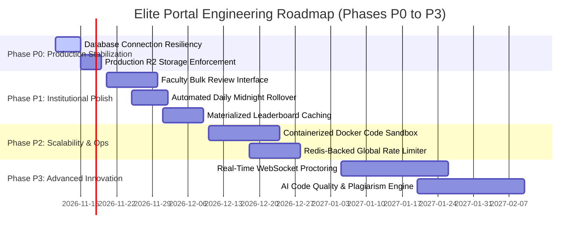

# ELITE PORTAL — PRIORITIZED DEVELOPMENT & ENGINEERING ROADMAP

**Document Version:** 2.0.0  
**Status:** Approved Reference  
**Platform:** Francis Xavier Engineering College | Elite Batch (2025–2029)  
**Planning Horizon:** Academic Year 2025–2026 / 4 Delivery Phases (P0 through P3)  

---

## 1. Roadmap Architecture & Prioritization Framework

---

## 2. Phase P0: Blockers & Critical Production Fixes (Immediate)

### Task P0-01: Persistent Database Connection Resiliency & Idle Pool Reconnection
- **Module:** Persistence / Database (`app/database.py`, `app/fastapi/app.py`)
- **Description:** Harden Neon DB connection pooling against abrupt serverless wakeups and network drops. Add automated retry logic on transient `psycopg2.OperationalError` during request lifecycle middleware.
- **Effort:** 3 Days
- **Dependencies:** None
- **Verification Criteria:** Server sustains 1,000 simulated requests with zero unhandled database disconnect exceptions.

### Task P0-02: Cloudflare R2 Production Configuration Enforcement
- **Module:** Object Storage (`app/services/storage.py`)
- **Description:** Implement strict startup health checks in production ensuring `R2_ENDPOINT_URL`, `R2_ACCESS_KEY_ID`, `R2_SECRET_ACCESS_KEY`, and `R2_BUCKET_NAME` are verified before accepting traffic. Prevent silent fallback to ephemeral container disk in production.
- **Effort:** 2 Days
- **Dependencies:** None
- **Verification Criteria:** Application fails fast on boot in production if R2 credentials fail connection validation.

---

## 3. Phase P1: Core Functional Polish & Production Essentials (Weeks 1–3)

### Task P1-01: Faculty Batch Evidence Review Queue
- **Module:** Faculty Portal (`app/fastapi/routers/faculty.py`, `frontend/src/pages/FacultyDashboard.tsx`)
- **Description:** Build high-efficiency keyboard shortcuts and bulk approval actions for faculty mentors reviewing large daily student queues (e.g., Approve All Verified, Quick Feedback Presets).
- **Effort:** 5 Days
- **Dependencies:** Task P0-02
- **Verification Criteria:** Faculty can review 50 daily submissions in under 5 minutes using keyboard navigation.

### Task P1-02: Automated Midnight Rollover & Streak Maintenance Worker
- **Module:** Background Automation (`app/services/portal.py`)
- **Description:** Deploy a lightweight background cron worker triggered at `00:01:00 IST` daily to calculate missed submissions, reset dormant streaks to 0, and archive past-day tasks.
- **Effort:** 4 Days
- **Dependencies:** None
- **Verification Criteria:** Inactive students have their streaks reset automatically at midnight without requiring manual login triggers.

### Task P1-03: Materialized Leaderboard Caching & Query Optimization
- **Module:** Analytics & Gamification (`app/fastapi/routers/student.py`)
- **Description:** Introduce an in-memory or Redis-cached leaderboard snapshot refreshed every 15 minutes to reduce database CPU overhead during peak morning contest hours.
- **Effort:** 4 Days
- **Dependencies:** Task P0-01
- **Verification Criteria:** `GET /api/v1/leaderboards` latency remains strictly under 30ms regardless of active student count.

---

## 4. Phase P2: Scalability, Infrastructure & Hardening (Weeks 4–6)

### Task P2-01: Containerized Docker Code Sandbox for Code Runner
- **Module:** Code Evaluation Engine (`app/services/code_runner.py`)
- **Description:** Transition compiler execution from host subprocesses to isolated, ephemeral, unprivileged Docker containers with network access disabled (`--network none`) and read-only host mounts.
- **Effort:** 10 Days
- **Dependencies:** Task P0-01
- **Verification Criteria:** Student code containing filesystem write attempts or socket connection attempts is completely blocked by container isolation.

### Task P2-02: Redis-Backed Distributed Rate Limiting & Session Cache
- **Module:** Infrastructure & Middleware (`app/fastapi/ratelimit.py`)
- **Description:** Replace single-process sliding window queue with a Redis cluster rate limiter to synchronize limits across horizontal Uvicorn worker replicas.
- **Effort:** 6 Days
- **Dependencies:** None
- **Verification Criteria:** Multi-worker deployments enforce unified IP rate limits across all nodes.

---

## 5. Phase P3: Advanced Innovation & Institutional Features (Weeks 7–12)

### Task P3-01: Real-Time WebSocket Assessment Proctoring
- **Module:** Assessment Subsystem (`app/fastapi/routers/student.py`)
- **Description:** Establish bi-directional WebSocket connections during active assessments to broadcast immediate proctoring alerts to faculty proctor dashboards upon tab switches or fullscreen exits.
- **Effort:** 12 Days
- **Dependencies:** Task P2-02
- **Verification Criteria:** Faculty proctor receives real-time UI notification within 500ms of a student switching browser tabs.

### Task P3-02: Automated AI Code Quality & Plagiarism Assessment
- **Module:** Academic Integrity Engine (`app/services/code_runner.py`)
- **Description:** Integrate AST-based structural similarity detection (MOSS algorithm) and LLM-assisted code quality analysis to flag copy-pasted solutions across student cohorts.
- **Effort:** 14 Days
- **Dependencies:** Task P2-01
- **Verification Criteria:** Detects code plagiarism across syntactically modified submissions (variable renaming, whitespace alterations) with $>95\%$ accuracy.
