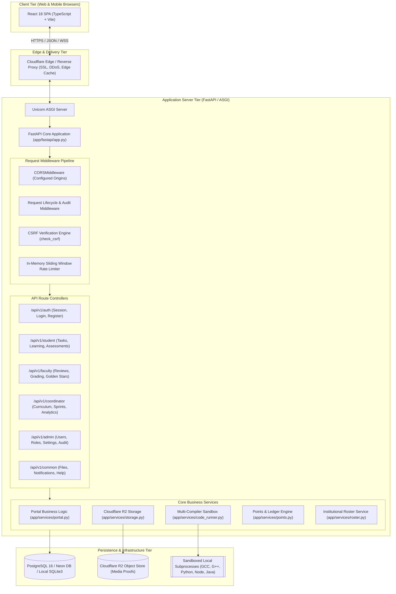
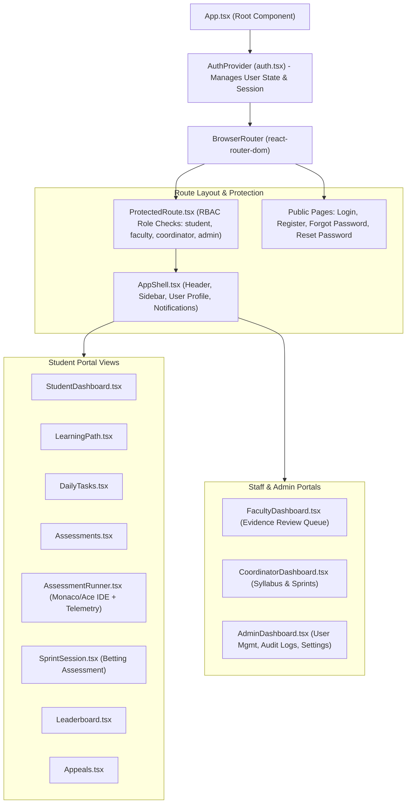
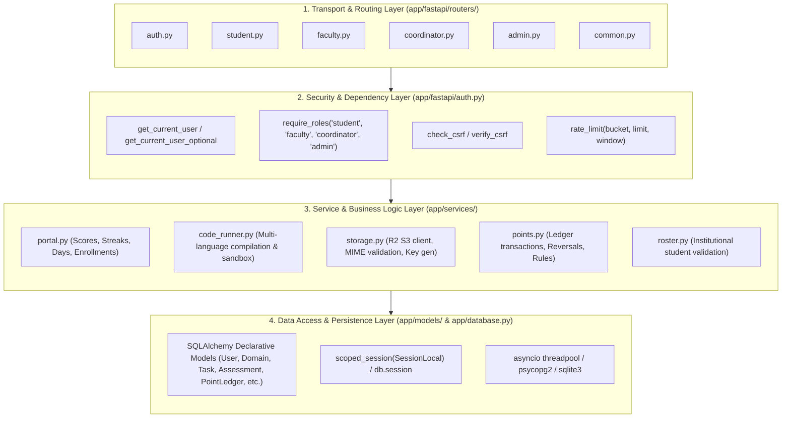
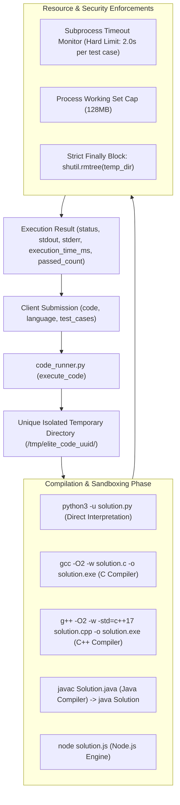
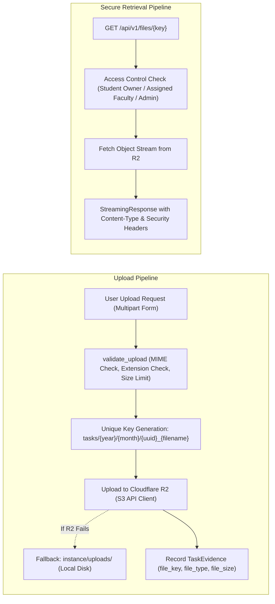

# ELITE PORTAL — SYSTEM ARCHITECTURE & TECHNICAL DESIGN

**Document Version:** 2.0.0  
**Status:** Approved Reference  
**Platform:** Francis Xavier Engineering College | Elite Batch (2025–2029)  
**Backend:** FastAPI (ASGI) on Python 3.10+ / Uvicorn  
**Frontend:** React 18 SPA / TypeScript / Vite / Tailwind CSS  
**Database:** PostgreSQL 16 (Neon DB Serverless) with Local SQLite3 Fallback  
**Storage:** Cloudflare R2 (S3-compatible) with Local Disk Fallback  

---

## 1. High-Level System Architecture

The Elite Portal is engineered as a decoupled client-server web application. The frontend is a high-performance single-page application (SPA) built on React 18 and Vite. The backend is an asynchronous, high-throughput ASGI application built on FastAPI, serving structured JSON APIs and delegating resource-intensive operations (such as code compilation and file storage) to dedicated backend subsystems.



---

## 2. Frontend Architecture (React 18 SPA)

The user interface is built as a modular React 18 application in `frontend/src/` configured with strict TypeScript typing, Tailwind CSS utility styling, and Vite bundling.

### 2.1. Component & Layout Architecture



### 2.2. State Management & API Integration
- **Authentication State:** Provided by `frontend/src/context/auth.tsx`. Stores user object, authentication status, and CSRF token.
- **API Client:** Encapsulated in `frontend/src/lib/api.ts`. Provides typed helper methods (`get`, `post`, `put`, `delete`, `upload`).
- **Dual-Token Transmission:** Automatically includes `credentials: "include"` for cookie delivery and sends `Authorization: Bearer <token>` from `localStorage` as a fallback. It automatically attaches `X-CSRF-Token` to all mutating requests.
- **Route-Level Code Splitting:** Implemented using `React.lazy()` and `Suspense` across 32 page components, reducing the initial JavaScript payload by over 60%.

---

## 3. Backend Layered Architecture (FastAPI)

The backend follows a clean, four-layer architecture ensuring strict separation of concerns, testability, and maintainability.



---

## 4. Authentication, Session & CSRF Lifecycle

The platform uses a robust dual-channel authentication architecture designed to eliminate browser cross-site tracking restrictions while maintaining strict CSRF defenses.

```mermaid
sequenceDiagram
    autonumber
    actor Student as Student Browser
    participant API as FastAPI Backend (/api/v1/auth)
    participant AuthEngine as Auth & Crypto Engine
    participant DB as Database (PostgreSQL)

    Student->>API: POST /api/v1/auth/login {portal, email, password, remember}
    API->>DB: User.query.filter_by(email=email).first()
    DB-->>API: User record (scrypt hash)
    API->>AuthEngine: user.check_password(password)
    AuthEngine-->>API: Password verified (True)
    API->>API: Verify portal role == user.role
    API->>AuthEngine: secrets.token_urlsafe(32) (Generate CSRF token)
    API->>AuthEngine: URLSafeTimedSerializer.dumps({_user_id, api_csrf, rem})
    AuthEngine-->>API: Signed Session Token
    API->>DB: Update user.last_login = now_utc(); COMMIT
    API-->>Student: HTTP 200 OK<br/>Set-Cookie: session=<token>; HttpOnly; SameSite=Lax<br/>Set-Cookie: elite_session=1; SameSite=Lax (hint)<br/>Body: {data: {token: <token>, csrf_token: <csrf>, user: {...}}}

    Note over Student: Browser stores csrf_token & token in localStorage

    rect rgb(240, 248, 255)
        Note over Student,API: Authenticated Mutating Request (e.g. Task Submission)
        Student->>API: POST /api/v1/student/tasks/1/evidence<br/>Header: X-CSRF-Token: <csrf><br/>Header: Authorization: Bearer <token><br/>Cookie: session=<token>
        API->>API: check_csrf(request) -> validate X-CSRF-Token matches session.api_csrf
        API->>AuthEngine: decode_session_token() -> verify signature & timestamp
        API->>DB: db.session.get(User, user_id)
        API->>API: Process task submission & write evidence
        API-->>Student: HTTP 200 OK {data: {submission_id: 101, status: "pending"}}
    end
```

---

## 5. Multi-Compiler Code Execution Engine

The code runner (`app/services/code_runner.py`) provides secure, isolated compilation and execution for 5 programming languages against automated test cases.



---

## 6. Secure Object Storage Architecture

The platform separates file uploads into public user assets (avatars) and confidential evidence assets (daily task proofs, video recordings).



---

## 7. Database Connection & Pooling Strategy

To prevent connection exhaustion and handle serverless connection dormancy (Neon DB PostgreSQL), the database layer is configured with robust pooling parameters:

```python
SQLALCHEMY_ENGINE_OPTIONS = {
    "pool_size": 10,           # Persistent active pool connections
    "max_overflow": 20,         # Burst connections allowed during spikes
    "pool_recycle": 300,        # Recycle connections every 5 minutes
    "pool_pre_ping": True,      # Test connection viability before issuing query
    "pool_timeout": 30,         # Maximum wait time for an available connection
}
```

Each HTTP request is bound to a dedicated scoped database session via `request_scope`. Uncommitted transactions are automatically rolled back, and sessions are cleanly removed in the middleware `finally` block:

```python
@app.middleware("http")
async def request_lifecycle_middleware(request: Request, call_next):
    # Set unique request scope token
    scope_token = request_scope.set(f"req-{req_id}")
    try:
        response = await call_next(request)
    finally:
        await run_in_threadpool(remove_session)
        request_scope.reset(scope_token)
```

---

## 8. Summary Architecture Metrics

| Metric | Target SLA | Implemented Architecture Design |
| :--- | :--- | :--- |
| **API Framework** | ASGI Async | FastAPI 0.115+ running on Uvicorn |
| **Database Pool** | 10 base, 30 max | SQLAlchemy Scoped Session with `pool_pre_ping` |
| **Session Lifetime** | 8h standard, 30d remember | ItsDangerous `URLSafeTimedSerializer` with salt separation |
| **CSRF Defense** | 100% mutating routes | Session-bound and cookie-bound token comparison (`compare_digest`) |
| **Code Runner Timeout** | 2.0s per test case | `subprocess.run(timeout=2.0)` with subprocess tree kill |
| **File Storage** | Zero local disk coupling | Cloudflare R2 via `boto3` client with local fallback |
