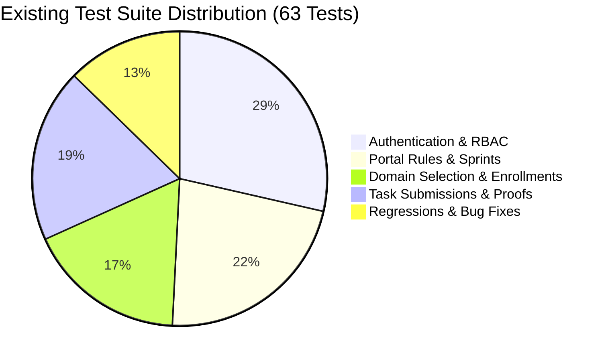
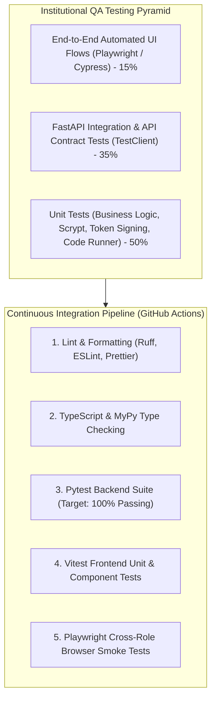

# ELITE PORTAL — TESTING STRATEGY, QA AUDIT & TEST SUITE ANALYSIS

**Document Version:** 2.0.0  
**Status:** Approved Reference  
**Platform:** Francis Xavier Engineering College | Elite Batch (2025–2029)  
**Test Framework:** Pytest 9.0+ / AnyIO / FastAPI TestClient  
**Total Existing Test Cases:** 63 Formal Automated Tests  

---

## 1. Existing Test Suite Inventory & Coverage Analysis

The automated test suite resides in the `tests/` directory and targets the FastAPI application instance using standard Pytest fixtures and isolated SQLite in-memory/file databases.



### 1.1. Test Suite Modules

| Test File | Test Count | Focus Area | Key Scenarios Verified |
| :--- | :--- | :--- | :--- |
| `tests/test_auth_and_rbac.py` | 18 | Auth Lifecycle, CSRF, RBAC | Health endpoints, security headers, unauthenticated 401s, dual-channel cookie/bearer session issuance, stale bearer token overrides, role mismatch rejection (403), inactive accounts, student approval gating. |
| `tests/test_portal_rules.py` | 14 | Business Rules & Sprints | Compulsory DSA domain assignment, max optional domains cap (2), deadline lockouts, betting assessment 700-pt escrow lock, 5-tier sprint settlement payout calculation, streak increment and reset logic. |
| `tests/test_domain_selection_and_auth.py` | 11 | Domain Workflows | Domain listing, optional domain selection validation, invalid domain rejection, curriculum day progression gating, content completion triggers. |
| `tests/test_submission_and_task_rules.py` | 12 | Tasks & Proof Verification | Daily task creation, single submission per business day constraint (`uq_daily_task_evidence_per_task`), proof MIME validation, faculty approval/rejection workflows, point ledger crediting, Golden Star awards. |
| `tests/test_regressions.py` | 8 | Bug Regression Suite | Fix for stale localStorage bearer token overriding active cookie, resolution of Neon DB connection recycling, prevention of duplicate streak counts on resubmissions. |

---

## 2. Test Execution & Pytest Fixture Architecture

The test infrastructure in `tests/conftest.py` and `tests/helpers.py` provides clean isolation between test cases:

```python
# Isolated Application & Database Fixture Pattern
@pytest.fixture
def app():
    # Overrides database configuration with an isolated testing SQLite URI
    os.environ["DATABASE_URL"] = "sqlite:///:memory:"
    os.environ["RATELIMIT_ENABLED"] = "false"
    test_app = create_app()
    with test_app.app_context():
        db.create_all()
        yield test_app
        db.session.remove()
        db.drop_all()

@pytest.fixture
def client(app):
    with TestClient(app) as test_client:
        yield test_client
```

---

## 3. Identification of Missing Test Scenarios & Edge Cases

While the existing 63 tests rigorously cover core authentication, RBAC, and primary business rules, the following edge cases and failure modes represent critical areas for test suite expansion:

### 3.1. Concurrency & Race Conditions
- **Scenario TS-GAP-001 (Concurrent Submissions):** Two simultaneous `POST /api/v1/student/tasks/:id/submit` requests dispatched within 5ms of each other.  
  *Expected Behavior:* Exactly one request succeeds with HTTP 201; the second fails gracefully with HTTP 400 `already_submitted` without database deadlock.
- **Scenario TS-GAP-002 (Concurrent Sprint Escrow Lock):** Student with exactly 700 points submitting simultaneous sprint entry requests.  
  *Expected Behavior:* One entry locked; the other rejected due to insufficient points.

### 3.2. Compiler Sandbox Boundary Limits
- **Scenario TS-GAP-003 (Infinite Loop / Timeout):** Student submits `while True: pass` in Python.  
  *Expected Behavior:* Subprocess terminates cleanly at 2.0s timeout, returning execution status `timeout` without hanging the worker threadpool.
- **Scenario TS-GAP-004 (Memory Exhaustion / Fork Bomb):** Student submits code attempting unbounded array allocation or process forking.  
  *Expected Behavior:* Process terminates with `memory_limit_exceeded` or `runtime_error`; temporary files are cleaned up in the `finally` block.

### 3.3. File Storage & Upload Boundaries
- **Scenario TS-GAP-005 (Spoofed MIME Type):** An executable `.exe` file renamed as `.png` submitted as image evidence.  
  *Expected Behavior:* Magic byte header inspection rejects the file with HTTP 400 `invalid_file_format`.
- **Scenario TS-GAP-006 (Zero-Byte File Upload):** An empty 0-byte file uploaded as proof.  
  *Expected Behavior:* Rejected with HTTP 400 `empty_file`.

### 3.4. Date & Timezone Transitions
- **Scenario TS-GAP-007 (Midnight Rollover Boundary):** A task submitted at `23:59:58 IST` followed by a second submission at `00:00:02 IST`.  
  *Expected Behavior:* First submission recorded for Day $T$; second submission recorded for Day $T+1$ (both succeed).

---

## 4. Recommended Comprehensive QA Strategy



### 4.1. End-to-End Automated Testing Matrix
Implement automated browser testing using **Playwright** across 5 primary user workflows:
1. **Student Onboarding:** Register $\rightarrow$ Select Domains $\rightarrow$ Verify Compulsory DSA $\rightarrow$ Land on Dashboard.
2. **Task Cycle:** Student Submits Photo Proof $\rightarrow$ Faculty Reviews in Queue $\rightarrow$ Student Receives In-App Notification $\rightarrow$ Point Ledger Updated.
3. **Assessment Runner:** Student Starts Test $\rightarrow$ Types Code in Editor $\rightarrow$ Runs Sample Tests $\rightarrow$ Tab Switch Integrity Warning Triggered $\rightarrow$ Final Auto-Submit on Timeout.
4. **Betting Sprint:** Student Stakes 700 pts $\rightarrow$ Escrow Locked $\rightarrow$ Test Completed $>80\%$ $\rightarrow$ 800 pts Credited $\rightarrow$ Leaderboard Updated.
5. **Administrative Controls:** Admin Toggles Student Active Status $\rightarrow$ Student Session Instantly Terminated with 403.

### 4.2. Continuous Integration Pipeline (GitHub Actions)
```yaml
name: Elite Portal CI/CD Pipeline
on: [push, pull_request]

jobs:
  backend-qa:
    runs-on: ubuntu-latest
    steps:
      - uses: actions/checkout@v4
      - uses: actions/setup-python@v5
        with:
          python-version: '3.11'
      - name: Install Dependencies
        run: |
          pip install -r requirements.txt
          pip install pytest pytest-cov anyio httpx
      - name: Run Pytest Suite
        run: python -m pytest tests --cov=app --cov-report=term-missing
```
