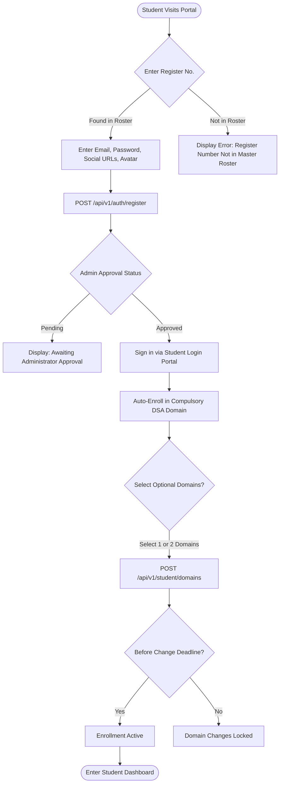
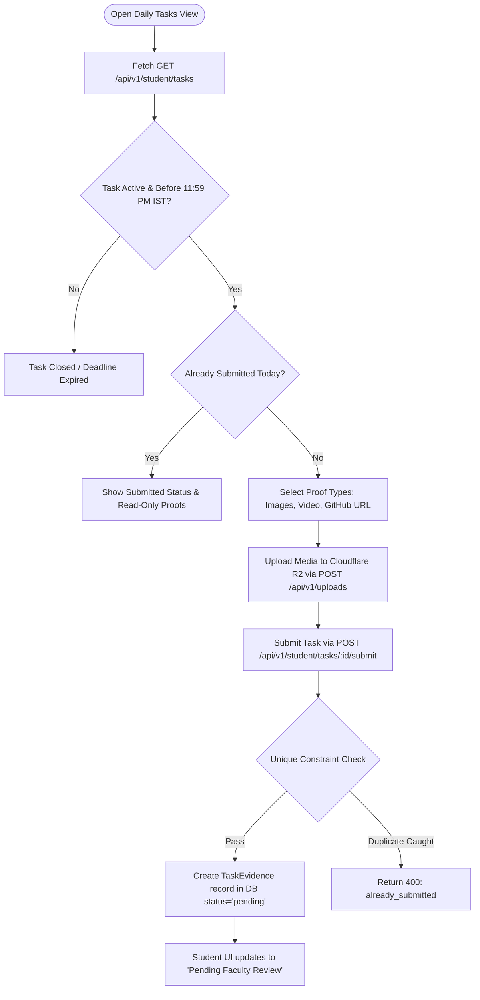
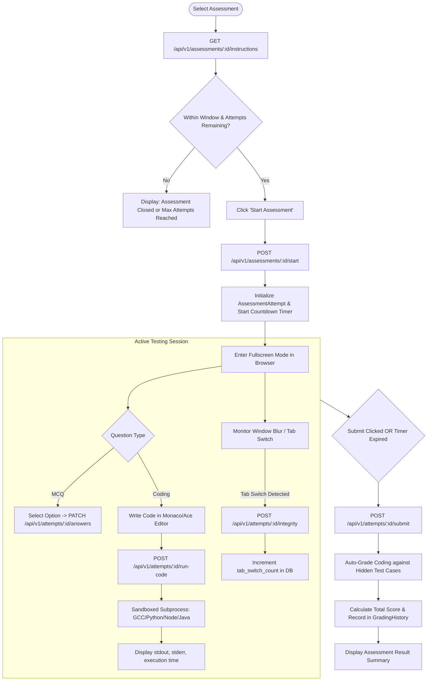
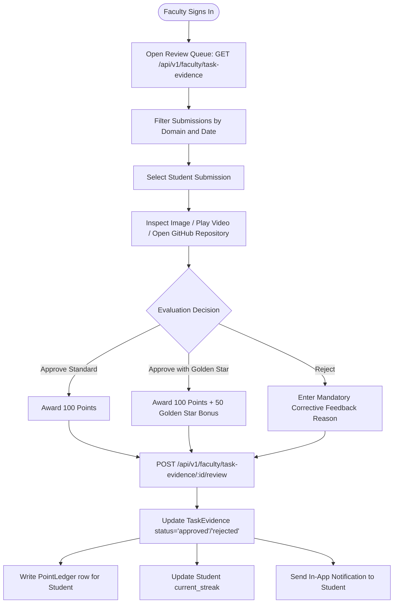
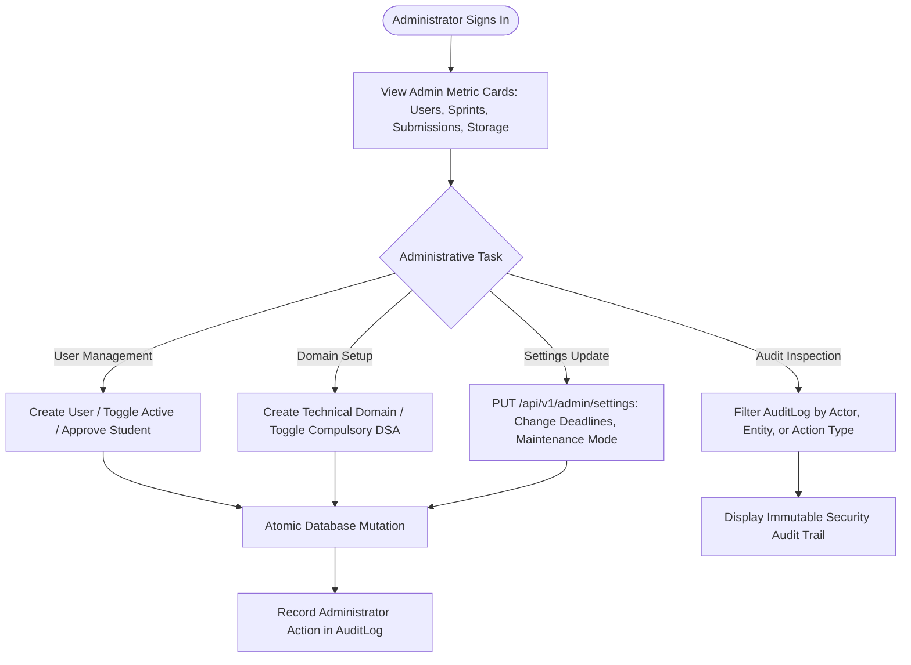

# ELITE PORTAL — END-TO-END USER FLOWS & WORKFLOW SPECIFICATION

**Document Version:** 2.0.0  
**Status:** Approved Reference  
**Platform:** Francis Xavier Engineering College | Elite Batch (2025–2029)  
**Roles Covered:** Student, Faculty Mentor, Faculty Coordinator, Domain Coordinator, Administrator  

---

## 1. Student User Journeys

### 1.1. Student Onboarding & Domain Selection Journey
- **Entry Point:** Public Landing Page (`/login`)
- **Frontend Views:** `LoginPage.tsx` $\rightarrow$ `RegisterPage.tsx` $\rightarrow$ `StudentDashboard.tsx` $\rightarrow$ `DomainSelectionModal.tsx`
- **Backend API Calls:**
  1. `POST /api/v1/auth/roster-lookup` (Validates registration number against college roster)
  2. `POST /api/v1/auth/upload-avatar` (Pre-registration avatar upload)
  3. `POST /api/v1/auth/register` (Account creation)
  4. `POST /api/v1/auth/login` (Authentication)
  5. `GET /api/v1/domains` (Fetch available domains)
  6. `POST /api/v1/student/domains` (Select up to 2 optional domains)



---

### 1.2. Daily Task Evidence Submission Journey
- **Entry Point:** Student Dashboard $\rightarrow$ Daily Tasks Tab
- **Frontend Views:** `DailyTasks.tsx` $\rightarrow$ `TaskSubmissionModal.tsx`
- **Business Constraint:** Strictly 1 submission per task per business day (`Asia/Kolkata`).



---

### 1.3. Assessment Pre-Flight, Code Runner & Proctoring Journey
- **Entry Point:** Student Dashboard $\rightarrow$ Assessments Tab
- **Frontend Views:** `Assessments.tsx` $\rightarrow$ `AssessmentInstructions.tsx` $\rightarrow$ `AssessmentRunner.tsx`



---

### 1.4. Strategic Betting Assessment (Sprint Session) Journey
- **Entry Point:** Student Dashboard $\rightarrow$ Active Sprints
- **Frontend Views:** `SprintSession.tsx`
- **Wager Mechanism:** 700 point escrow stake with stratified 5-tier return.

```mermaid
flowchart TD
    A([Open Sprint Assessment]) --> B[Inspect 5-Tier Payout Matrix]
    B --> CheckBalance{Current Points >= 700?}
    CheckBalance -->|Insufficient Points| BlockEntry[Cannot Enter: Balance Below Wager Amount]
    CheckBalance -->|Sufficient| ConfirmWager[Confirm Wager of 700 Points]
    
    ConfirmWager --> LockEscrow[Debit 700 pts to PointLedger category='sprint_lock']
    LockEscrow --> CreateBid[Create EliteSprintBid status='locked']
    CreateBid --> StartExam[Complete Assessment Sitting]
    
    StartExam --> ExamClosed[Testing Window Closes & Settlement Runs]
    ExamClosed --> TierEval{Evaluate Final Marks %}
    
    TierEval -->|> 80%| Tier1[Tier 1: Above 80% -> Escrow 700 + Att 100 = 800 pts (Net +100)]
    TierEval -->|40% to 80%| Tier2[Tier 2: 40-80% -> Escrow 350 + Att 100 = 450 pts (Net -250)]
    TierEval -->|1% to 39%| Tier3[Tier 3: 1-39% -> Escrow 0 + Att 100 = 100 pts (Net -600)]
    TierEval -->|Attended & 0%| Tier4[Tier 4: Attended Zero -> Escrow 0 + Att 50 = 50 pts (Net -650)]
    TierEval -->|Absent| Tier5[Tier 5: Absent -> Total Forfeiture = 0 pts (Net -700)]
    
    Tier1 --> SettlePayout[Credit Payout to PointLedger category='sprint_payout']
    Tier2 --> SettlePayout
    Tier3 --> SettlePayout
    Tier4 --> SettlePayout
    Tier5 --> SettlePayout
    SettlePayout --> UpdateStatus[Mark EliteSprintBid settled=True]
```

---

## 2. Faculty Mentor User Journey

### 2.1. Daily Task Review & Grading Journey
- **Entry Point:** Faculty Portal (`/faculty`)
- **Frontend Views:** `FacultyDashboard.tsx` $\rightarrow$ `EvidenceReviewModal.tsx`



---

## 3. Coordinator User Journeys

### 3.1. Domain Curriculum & Learning Day Authoring Journey
- **Entry Point:** Coordinator Portal (`/coordinator`)
- **Frontend Views:** `CoordinatorDashboard.tsx` $\rightarrow$ `CurriculumManager.tsx` $\rightarrow$ `DayEditorModal.tsx`

```mermaid
flowchart TD
    A([Domain Coordinator Signs In]) --> B[Select Managed Domain]
    B --> C[Fetch Curricular Days: GET /api/v1/coordinator/domains/:id/days]
    C --> Action{Curriculum Action}
    
    Action -->|Create Day| AddDay[POST /api/v1/coordinator/domains/:id/days {day_number, title, description}]
    Action -->|Add Material| AddMat[POST /api/v1/coordinator/days/:id/materials {type, url, content}]
    Action -->|Reorder| Reorder[POST /api/v1/coordinator/days/reorder {ordering_map}]
    Action -->|Publish| PubDay[POST /api/v1/coordinator/days/:id/publish]
    
    AddDay --> DBCommit[Commit to Database]
    AddMat --> DBCommit
    Reorder --> DBCommit
    PubDay --> DBCommit
    DBCommit --> Audit[Log Action in AuditLog]
    Audit --> Realtime[Immediately Visible to Enrolled Students]
```

---

## 4. Administrator User Journey

### 4.1. Platform Governance & System Configuration Journey
- **Entry Point:** Admin Portal (`/admin`)
- **Frontend Views:** `AdminDashboard.tsx` $\rightarrow$ `UserManagement.tsx` $\rightarrow$ `SystemSettings.tsx` $\rightarrow$ `AuditViewer.tsx`


